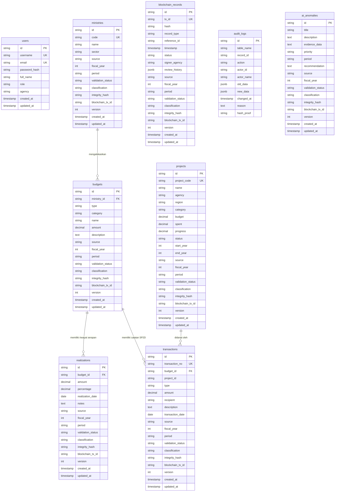

# Skema & Entity Relationship Diagram (ERD) — Nusantara Transparan

Dokumen ini menjelaskan struktur lengkap database PostgreSQL untuk proyek **Nusantara Transparan** yang telah dibuat melalui GORM AutoMigrate.

---

## 1. Visual Diagram Relasi (Mermaid ERD)

---

## 2. Rincian Tabel & Fungsinya

| Nama Tabel | Domain | Keterangan & Kepatuhan Aturan |
| :--- | :--- | :--- |
| **`users`** | Autentikasi | Pengelolaan hak akses berjenjang (*Admin, Auditor, Data Manager, Public*). |
| **`ministries`** | Organisasi | Master data Kementerian / Lembaga negara (Kemenkeu, Kemenkes, PUPR, dll.). |
| **`budgets`** | **Anggaran (Pagu)** | **Aturan 8 (Pemisahan Domain):** Alokasi dana yang direncanakan (Revenue / Expenditure). |
| **`realizations`** | **Realisasi** | **Aturan 8 (Pemisahan Domain):** Serapan kumulatif dana yang telah digunakan (% serapan). |
| **`transactions`** | **Transaksi** | **Aturan 8 (Pemisahan Domain):** Transaksi per kejadian spesifik (nomor SP2D, kuitansi, vendor penerima). |
| **`projects`** | Proyek Fisik | Pemantauan progres fisik (%), anggaran terpakai, lokasi wilayah, dan status. |
| **`blockchain_records`** | Integritas | **Aturan 3 (Hash Only):** Bukti kriptografi (SHA-256) dan ID transaksi Hyperledger Fabric. |
| **`audit_logs`** | Jejak Audit | **Aturan 7 (Append-Only):** Riwayat perubahan data tanpa *hard delete*. |
| **`ai_anomalies`** | Kecerdasan Buatan | **Aturan 4 (Read-Only AI):** Temuan pola anomali dan rekomendasi dari mesin analitik. |

---

## 3. Metadata Wajib di Setiap Tabel Finansial (Aturan 6 & 9)

Setiap entitas data keuangan wajib memiliki kolom metadata berikut:
- **`source`**: Instansi resmi penerbit data (misal: `"Kemenkeu RI (APBN 2026)"`).
- **`fiscal_year`**: Tahun anggaran (misal: `2026`).
- **`period`**: Periode data (misal: `"Jan - Nov 2026"` atau `"Q3"`).
- **`validation_status`**: Status kurasi (`draft`, `reviewed`, `approved`, `published`).
- **`classification`**: Tingkat kerahasiaan (`public`, `restricted`, `confidential`).
- **`integrity_hash`**: Hash SHA-256 data untuk diverifikasi dengan ledger blockchain.
- **`blockchain_tx_id`**: Nomor transaksi pencatatan di konsorsium blockchain.
- **`version`**: Nomor versi data untuk mendukung *audit trail*.
